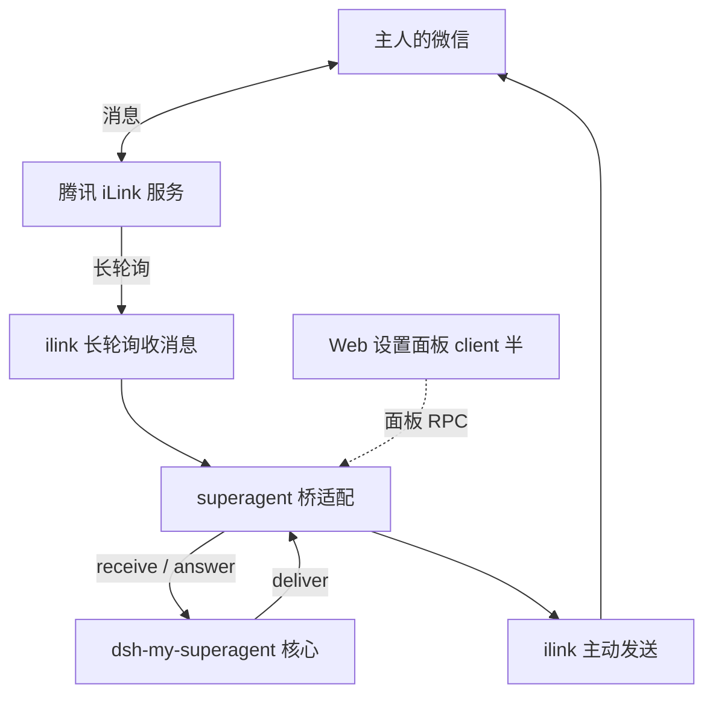

# 设计决策索引：dsh-im-wechat

把微信（WeChat，腾讯 iLink 协议）接入 DeepSeek Harness、作为超级助理 IM 桥的插件。本目录存放架构决策记录（ADR），每篇独立可读；本文件只做导航、汇总与「还没定的事」。

字段、客户端行为、上游版本差异这类**外部事实**不写在这里，放 [`docs/protocol/`](../protocol/README.md)——事实变了直接改那一份，不为事实变更另立 ADR。

## 一句话方案

**两半式 dsh 插件**：host 半跑在 DSH Host 进程内，包含自写的 iLink 协议客户端与 `my-superagent/v1` 桥适配；client 半是 Web 设置面板。微信侧用长轮询收消息、主动接口发消息，不需要公网回调地址；协议实现只参考腾讯官方 `openclaw-weixin` 的接口定义，零运行时依赖。

## 决策清单

| ADR | 标题 | 状态 |
| --- | --- | --- |
| [0001](0001-基于openclaw-weixin的零依赖微信桥.md) | 基于 openclaw-weixin 的零依赖微信桥 | 已采纳 |
| [0002](0002-登录态与二维码呈现.md) | 登录态与二维码呈现 | 已采纳 |
| [0003](0003-一期只做桥不做独立直聊.md) | 一期只做桥，不做独立直聊 | 已采纳 · 一期范围，边界被 0009 修订 |
| [0004](0004-图片入站与下载安全.md) | 图片入站与下载安全 | 已采纳 · 出站边界被 0010 修订 |
| [0005](0005-交互以文字呈现.md) | 交互以文字呈现，不声明交互卡能力 | 已采纳 |
| [0006](0006-问题提醒与长任务提醒归谁发.md) | 问题提醒与长任务提醒归谁发 | 已采纳 |
| [0007](0007-输入状态.md) | 输入状态（正在输入） | 已采纳 |
| [0008](0008-微信原生Markdown与出站文本过滤.md) | 微信原生 Markdown 与出站文本过滤 | 已采纳 · 同日修订过结论 |
| [0009](0009-独立模式的直连会话.md) | 独立模式的直连会话 | 已采纳 · 修订 0003 的边界 |
| [0010](0010-出站发图.md) | 出站发图 | 已采纳 · 修订 0004 的出站边界 |
| [0011](0011-失败立刻提醒.md) | 失败立刻提醒 | 已归档 · 判据移入 AGENTS.md |
| [0012](0012-出站快捷命令.md) | 出站快捷命令 `dsh-wechat-send` | 已采纳 |
| [0013](0013-声明推送窗口.md) | 声明 `context_token` 的推送窗口 6 小时 | 已采纳 |
| [0014](0014-跟随openclaw-weixin-3.0.0-beta的绑定兼容.md) | 跟随 openclaw-weixin 3.0.0-beta 的绑定兼容 | 已采纳 |

状态用三种：**已采纳**、**被 NNNN 修订**（决策后来变了，旧篇保留原文，由新篇取代）、**已归档**（结论仍在用，但已并入别处，不再维护）。改决策要新开一篇并在两边互相标注；只更新事实就直接改 `docs/protocol/`。

## 还没定的事

- 真机实测后要修订的数字：连发限流条数、长轮询超时、`longpolling_timeout_ms` 的实际取值。
