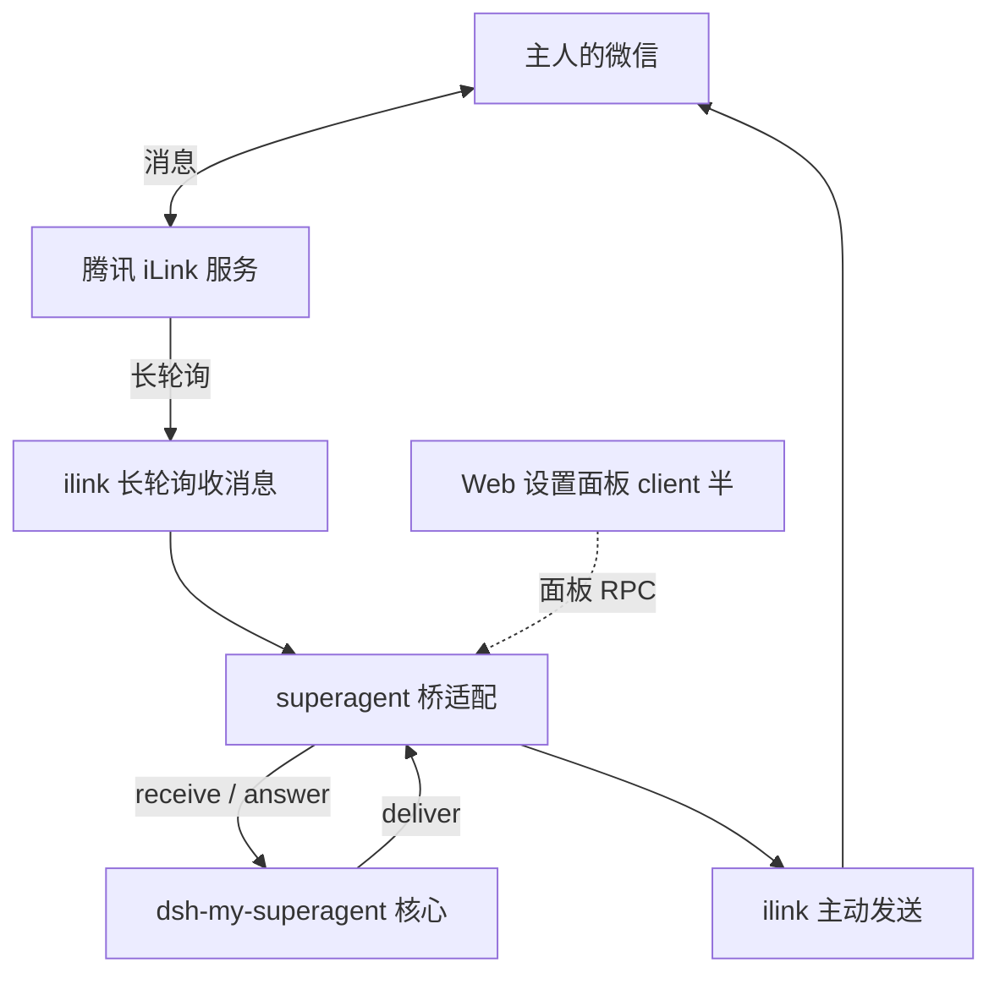

# 设计决策索引：dsh-im-wechat

把微信（WeChat，腾讯 iLink 协议）接入 DeepSeek Harness、作为超级助理 IM 桥的插件。本目录存放架构决策记录（ADR），每篇独立可读；本文件只做导航、汇总与「还没定的事」。

## 一句话方案

**两半式 dsh 插件**：host 半跑在 DSH Host 进程内，包含自写的 iLink 协议客户端与 `my-superagent/v1` 桥适配；client 半是 Web 设置面板。微信侧用长轮询收消息、主动接口发消息，不需要公网回调地址；协议实现只参考腾讯官方 `openclaw-weixin` 的接口定义，零运行时依赖。

## 决策清单

| ADR | 标题 | 状态 |
| --- | --- | --- |
| [0001](0001-基于openclaw-weixin的零依赖微信桥.md) | 基于 openclaw-weixin 的零依赖微信桥 | 已采纳 |

## 还没定的事

- 登录态与二维码呈现方式（面板展示 vs 落盘提示）。
- 交互卡与文字作答的呈现策略（核心文字匹配兜底，桥能力如何声明）。
- 是否提供独立于核心的直聊模式（独立模式），一期范围待定。
- 图片入站的下载安全策略（参考如流桥的既有约束，按微信端点另立规则）。
